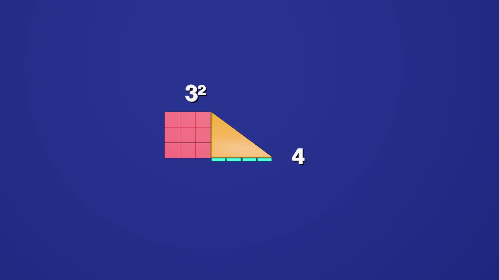
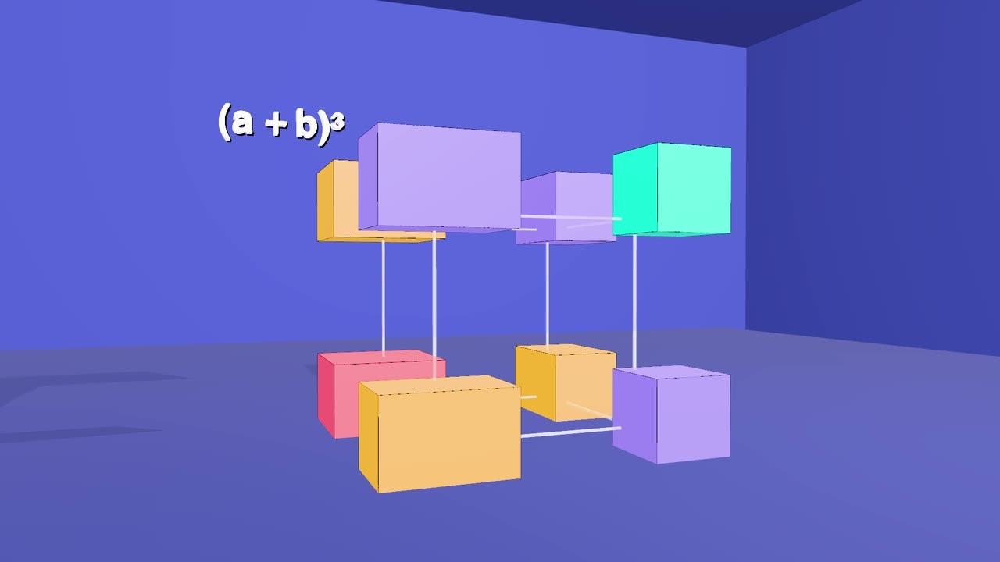
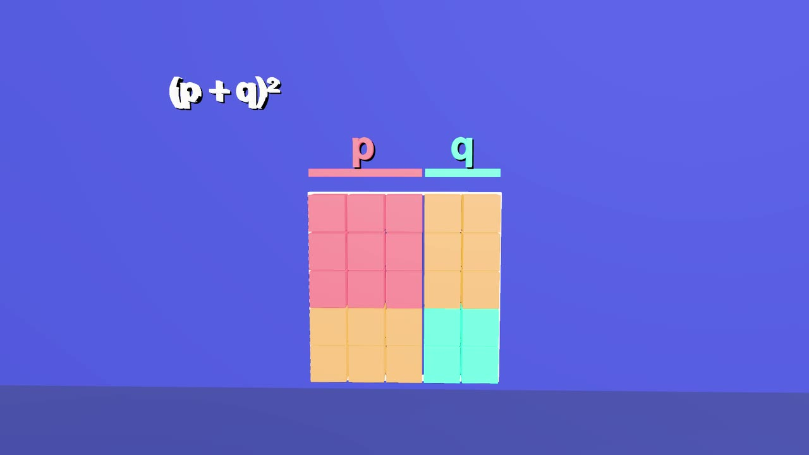
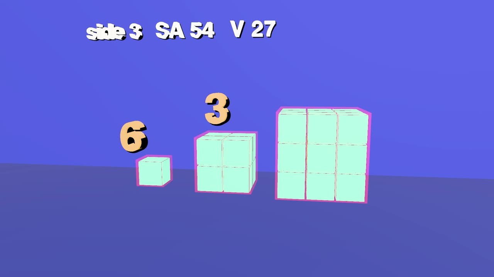
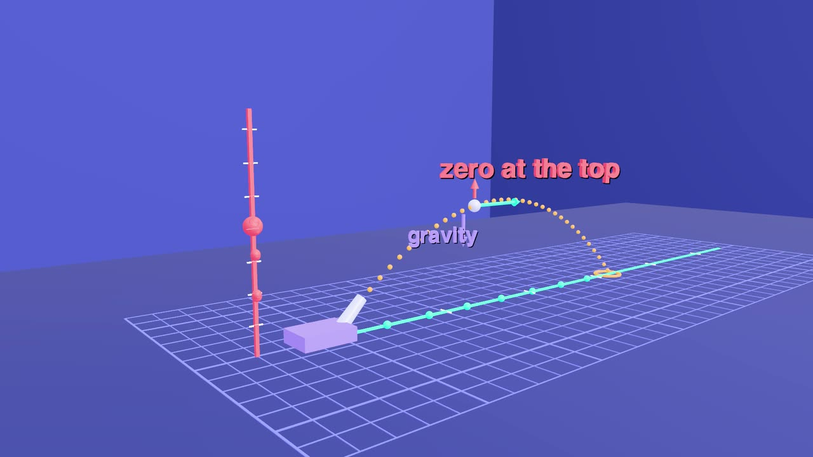
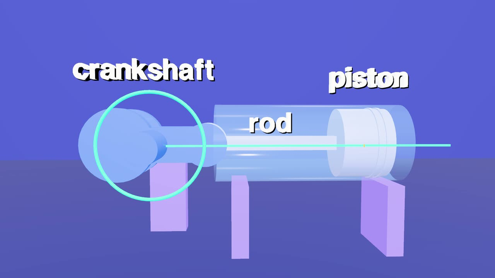

<h1>Short films that ship their own source</h1>

Watch one, then open the scene that made it, edit it, and read the tutorial that built it. Every one of these shows a relationship by making it geometric.

<strong>Demonstration</strong> shows a relationship in particular cases. <strong>Derivation</strong> argues it for every case its assumptions cover. Each film states which it is, and what it assumes.

<section>
<h2 id="s-maths">Maths</h2>
<ul class="cards">
<li>
<article class="card">

<h3><a href="/films/pythagoras/">Squares on a right triangle</a></h3>

Pythagorean theorem &middot; 2:09 &middot; Demonstration

On a right triangle, the squares on the two legs together cover exactly the square on the hypotenuse: 3² + 4² = 5², shown with tiles, then again for 5-12-13 and 8-15-17.

Ships its own source:
<a class="open-scene" href="https://strataeditor.dev/#repo=tejaswigowda/test1&file=pyth.json&branch=main">Open the scene</a> &middot; <a href="https://strataeditor.dev/about/tutorials/makeshort.html">Tutorial</a>

</article>
</li>
<li>
<article class="card">

<h3><a href="/films/a-plus-b-cubed/">A cube cut into eight blocks</a></h3>

(a + b)³ &middot; 0:51 &middot; Derivation

A cube of side a + b, cut at a along each edge, falls into eight blocks (one a³, three a²b, three ab², one b³), so (a + b)³ = a³ + 3a²b + 3ab² + b³ for positive lengths a and b.

Ships its own source:
<a class="open-scene" href="https://strataeditor.dev/#repo=tejaswigowda/test1&file=a%2Bb-cubed.json&branch=main">Open the scene</a> &middot; <a href="https://strataeditor.dev/about/tutorials/a-plus-b-cubed.html">Tutorial</a>

</article>
</li>
</ul>
</section>
<section>
<h2 id="s-biology">Biology</h2>
<ul class="cards">
<li>
<article class="card">

<h3><a href="/films/hardy-weinberg/">Hardy–Weinberg as a square</a></h3>

Hardy–Weinberg law &middot; 1:57 &middot; Demonstration

With random mating, one generation of offspring comes in the proportions p² + 2pq + q², drawn as a square, and the allele frequencies p and q are unchanged afterwards.

Ships its own source:
<a class="open-scene" href="https://strataeditor.dev/#repo=tejaswigowda/test1&file=hw.json&branch=main">Open the scene</a> &middot; <a href="https://strataeditor.dev/about/tutorials/hardy-weinberg.html">Tutorial</a>

</article>
</li>
<li>
<article class="card">

<h3><a href="/films/area-volume/">Why cells are small</a></h3>

surface area to volume &middot; 1:41 &middot; Demonstration

For cubes, surface area divided by volume is 6, 3 and 2 for sides 1, 2 and 3, falling as 1 / side, so a bigger cell has less surface for each bit of interior.

Ships its own source:
<a class="open-scene" href="https://strataeditor.dev/#repo=tejaswigowda/test1&file=area-volume.json&branch=main">Open the scene</a> &middot; <a href="https://strataeditor.dev/about/tutorials/area-volume.html">Tutorial</a>

</article>
</li>
</ul>
</section>
<section>
<h2 id="s-physics">Physics</h2>
<ul class="cards">
<li>
<article class="card">

<h3><a href="/films/projectile/">Two motions at once</a></h3>

projectile motion &middot; 1:21 &middot; Demonstration

A thrown ball's path is two independent motions: constant horizontal speed, and vertical motion under constant gravity.

Ships its own source:
<a class="open-scene" href="https://strataeditor.dev/#repo=tejaswigowda/test1&file=projectile.json&branch=main">Open the scene</a> &middot; <a href="https://strataeditor.dev/about/tutorials/projectile.html">Tutorial</a>

</article>
</li>
</ul>
</section>
<section>
<h2 id="s-mechanism">Mechanism</h2>
<ul class="cards">
<li>
<article class="card">

<h3><a href="/films/piston/">A crank, a rod and a piston</a></h3>

crank-slider kinematics &middot; 1:45 &middot; Demonstration

In a crank-slider the piston reaches its dead centers at the ends of the stroke, and the leverage of a steady push on the piston vanishes there and is largest near the middle of the stroke.

Ships its own source:
<a class="open-scene" href="https://strataeditor.dev/#repo=tejaswigowda/test1&file=piston.json&branch=main">Open the scene</a> &middot; <a href="https://strataeditor.dev/about/tutorials/piston.html">Tutorial</a>

</article>
</li>
</ul>
</section>
